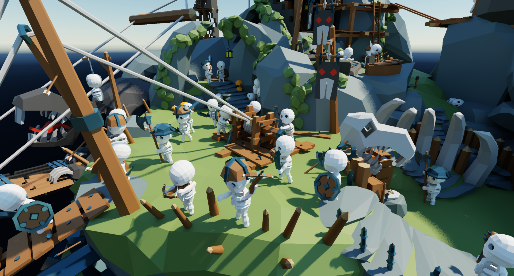
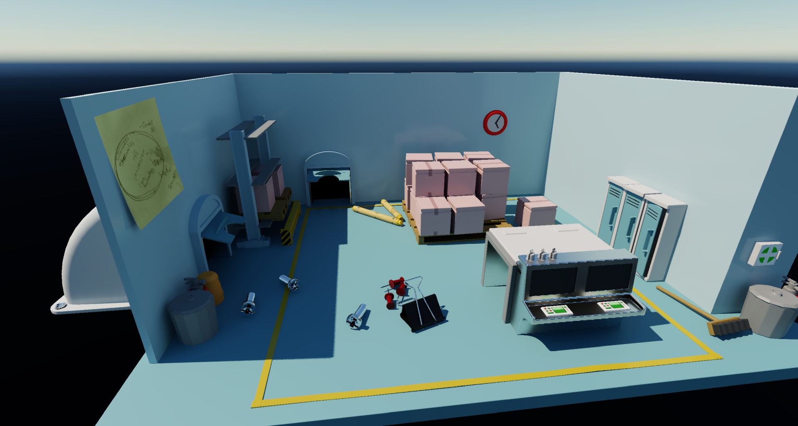
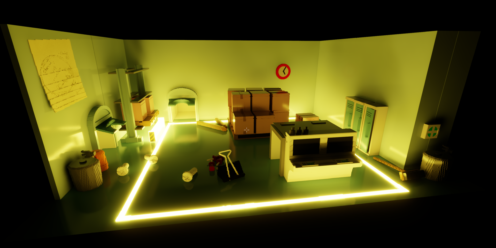
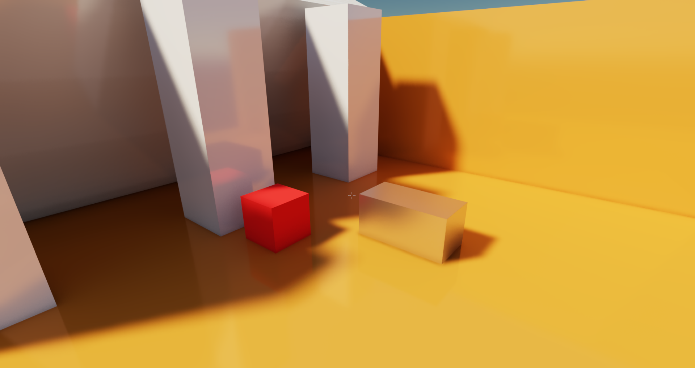
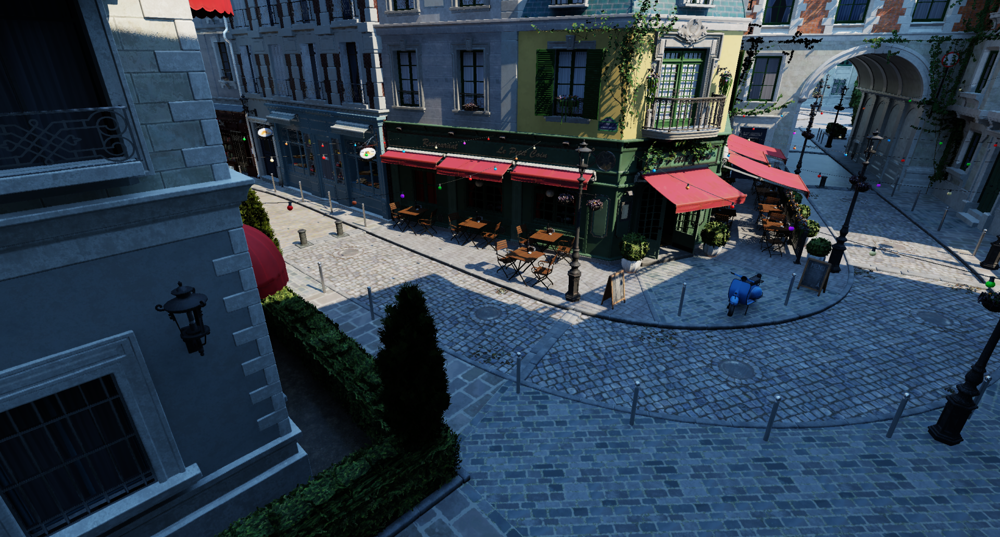

# gfx.h
A fast, single header minimal dependency Vulkan library, written in mostly sane C++.

C++20 is required for designated initializers, but includes are kept at a minimum.

## Features
* Bindless textures, dynamic rendering, push constants and buffer addresses, no descriptor sets to manage
* Barriers placed automatically from what each pass reads and writes
* Structs shared between C++ and GLSL with layout validation
* Built in GPU memory allocator or VMA
* No per frame heap allocations
* Ray tracing support

## Usage
In exactly one .cpp file:

```cpp
#define GFX_IMPLEMENTATION
#define GFX_WINDOW_WIN32
#include "gfx.h"
```

Everywhere else just include `gfx.h`.

## Showcase
<p align="center">  
  
  
  
  
  
</p>


## Minimal sample

```cpp
gfx::Device& device = gfx::CreateDevice(
{
    .app_name = "hello",
    .window = hwnd,
});

struct TriangleConstants
{
    float color[4];
    float time;
};

while (running)
{
    gfx::Frame frame = device.NewFrame();
    gfx::CommandBuffer& cmd = frame.cmd;

    const gfx::Handle<gfx::Texture> backbuffer = device.GetSwapchainTexture();
    if (backbuffer.IsValid())
    {
        cmd.BeginRenderPass(
        {
            .color_targets =
            {
                {
                    .texture = backbuffer,
                    .clear_color = { 0.1f, 0.1f, 0.1f, 1.0f },
                },
            },
        });
        cmd.BindPipeline(pipeline, gfx::BindPoint::Graphics);
        cmd.PushConstants(TriangleConstants
        {
            .color = { 1.0f, 0.5f, 0.2f, 1.0f },
            .time = time,
        });
        cmd.Draw(3, 1);
        cmd.EndRenderPass();
    }
    device.SubmitFrame(frame);
}

gfx::DestroyDevice(device);
```

## Shared structs
Write a struct once in a header that both C++ and GLSL include:

```cpp
// shared.h
#include "gfx_shared.h"

struct FrameData
{
    mat4 view_projection;
    vec4 camera_position;
    float time;
};
GFX_LAYOUT(FrameData, GFX_MEMBERS(view_projection, camera_position, time))
```

```cpp
cmd.SetGlobalConstants(FrameData{ .view_projection = view_projection, .camera_position = camera_position, .time = time });
```

```glsl
#include "shared.h"

layout(set = 1, binding = 0) uniform Globals { FrameData frame; };
```
`GFX_LAYOUT` checks the std430 layout at compile time and against the shader at runtime

## Configuration
Define these before including `gfx.h`

| Option | Default | |
|---|---|---|
| `GFX_WINDOW_WIN32` / `GFX_WINDOW_GLFW` | headless | Window type of `DeviceConfig::window` |
| `GFX_DEBUG` | on unless `NDEBUG` | Debug checks and logging |
| `GFX_ENABLE_VALIDATION` | `GFX_DEBUG` | Validation layer, debug names and labels |
| `GFX_USE_SPIRV_REFLECT` | 0 | Shader reflection, `GFX_LAYOUT` checks against shaders |
| `GFX_USE_VMA` | 0 | VMA instead of the built-in allocator |
| `GFX_USE_GLM` | off | glm types for vectors |
| `GFX_HANDLE_64` | 0 | 64 bit handles instead of 32 bit |
| `GFX_LOG_FN` | none | add #define gfx::GFX_Log `gfx::GFX_Log` for logging |


## Optional includes
Include `gfx_bindless.h` from shaders, it declares the bindless arrays for GLSL

If you want to use layout validation, include `gfx_shared.h` from C++ and GLSL


## Samples
`samples/triangle` small triange demo

`samples/minimal_rt` simple picapica ray traced scene


## Requirements
* A GPU and driver with Vulkan 1.3
* The Vulkan SDK headers
* A C++20 compiler, tested with MSVC on Windows

Optional: GLFW, VMA, SPIRV-Reflect and glm.